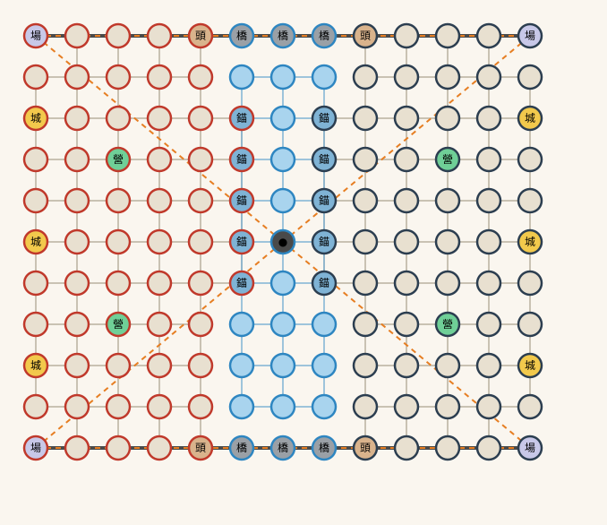

# B. 棋盘结构及可视化草图（第一阶段）

> ⚠️ 本文件为第一阶段产物。第二阶段已依历史棋盘特征重建棋盘（13×11，含铁桥/桥头、海上白线、航线黑点），见 [`docs/05-phase2-report.md`](05-phase2-report.md) 与 `data/board.json`（`status: RECONSTRUCTED`）。下方第一阶段「临时布局」已转为测试数据 `data/board.legacy.json`。

## 1. 已确认的结构性事实（有依据）

来自维基百科「操作指南」（已逐条核对），这些是**必须遵守**的硬约束：

1. 棋盘中间为**海洋**。
2. **两条铁路**在两旁连接两方（横贯全宽，越过海洋）。
3. **海岸线有锚点**——军舰开局必须放锚点。
4. 陆上有**兵站**——陆军棋子开局必须放兵站。
5. **三座城市**——军旗必须放城市。
6. **两个行营**——进入后敌方陆军不得攻击（安全区）。
7. 铁路——陆军一回合可行三格。
8. 每方**角落两个飞机场**——可放飞机。
9. 棋盘中有**航线**穿越各处。

## 2. 临时/推断布局（严格标注）

> ⚠️ **维基百科与所有可访问资料均未给出棋盘的精确坐标与拓扑。**
> 下面的 `data/board.json` 是**为原型开发而设计的临时布局**，只满足上述 9 条定性约束，
> **不代表已验证的传统布局**。引擎必须数据驱动，取得实物棋盘影像后整体替换本文件即可，
> 规则引擎与棋子数据无需改动。

### 2.1 几何规格

- 网格：**13 列 × 9 行**（行 0..8、列 0..12）。
- 红方陆地：列 0..4；**海洋：列 5..7**（行 1..7）；黑方陆地：列 8..12。
- 铁路：**第 0 行与第 8 行**，横贯全宽（含跨海桥接节点），连接红黑两方。
- 航线：两条**对角线**连接四角飞机场，交会于中央海域上空。

### 2.2 每方节点数量

| 类型 | 红方 | 黑方 | 用途 |
|---|---|---|---|
| 兵站 station | 38 | 38 | 陆军（11 官兵 + 11 武器 = 22 枚）开局部署 |
| 城市 city | 3 | 3 | 军旗部署（军旗占其一） |
| 行营 camp | 2 | 2 | 安全区 |
| 飞机场 airfield | 2 | 2 | 飞机（战斗机/侦察机）部署 |
| 锚点 anchor | 5 | 5 | 军舰（5 枚）部署 |

> 38 兵站 ≥ 22 陆军棋子，且留有余量供部署选择与布阵变化。

### 2.3 线路类型

| 线路 | 数据字段 | 说明 |
|---|---|---|
| 公路 road | `edges.road` | 陆地区域正交相邻，1 格移动 |
| 铁路 railway | `edges.railway` | 第 0/8 行横贯，陆军一回合最多 3 格 |
| 海面 sea | `edges.sea` | 海洋区域正交相邻，1 格移动 |
| 航线 air | `edges.air` | 有序节点列表（两条对角线），飞机/飞弹使用 |

## 3. 数据模型（`data/board.json`）

```jsonc
{
  "meta": { "status": "PROVISIONAL", "rows": 9, "cols": 13, ... },
  "nodes": {
    "r0c0": { "id": "r0c0", "row": 0, "col": 0, "side": "red", "type": "airfield" },
    "...":  {}
  },
  "edges": {
    "road":    [["r1c1", "r1c2"], ...],
    "railway": [["r0c0", "r0c1"], ...],
    "sea":     [["r1c5", "r1c6"], ...],
    "air":     [["r0c0", ..., "r8c12"], ["r8c0", ..., "r0c12"]]
  }
}
```

- `side` ∈ `red | black | sea`（海面与跨海桥接节点为 `sea`）。
- `type` ∈ `station | city | camp | airfield | anchor | sea | bridge`。
- `bridge` 为第 0/8 行海面列的铁路跨海节点（仅通行、不可部署）。

## 4. 可视化草图



（`docs/board-sketch.svg`，可用浏览器直接打开查看。）

图例：深灰粗线=铁路；浅灰细线=公路；蓝线=海面；橙色虚线=航线；金色圆=城市；绿色圆=行营；蓝环=锚点；紫灰圆=机场；米色圆=兵站；灰圆=跨海桥接点。

## 5. 移动规则（临时口径，待确认）

| 棋子 | 移动 |
|---|---|
| 陆军（官兵 + 可动武器） | 公路 1 格；铁路一回合最多 3 格（沿铁路直线、不可越子） |
| 不可动棋子（军旗/地雷/陷阱/炮垒） | 不移动 |
| 飞弹 | 陆上同陆军；亦可沿航线飞行（可越子） |
| 军舰 | 海面 1 格（锚点↔海面） |
| 主力舰/巡洋舰 | 海面 1 格 + 可两栖登陆（登陆后按等同军官/武器行事） |
| 战斗机/侦察机 | 沿航线直线无限远（转弯要停） |

> 上述速率除「铁路 3 格」与「飞机无限远/转弯停」外均为推断，详见 `docs/01` §6。

## 6. 与棋子的部署绑定

| 部署区域 | 棋子 |
|---|---|
| 兵站 | 陆军 22 枚（官兵 + 武器） |
| 城市 | 军旗（3 座城市任选其一） |
| 锚点 | 军舰 5 枚 |
| 飞机场 | 战斗机、侦察机各 1 |

自动布阵需遵守以上部署限制（第二阶段实现，见 `docs/04`）。
